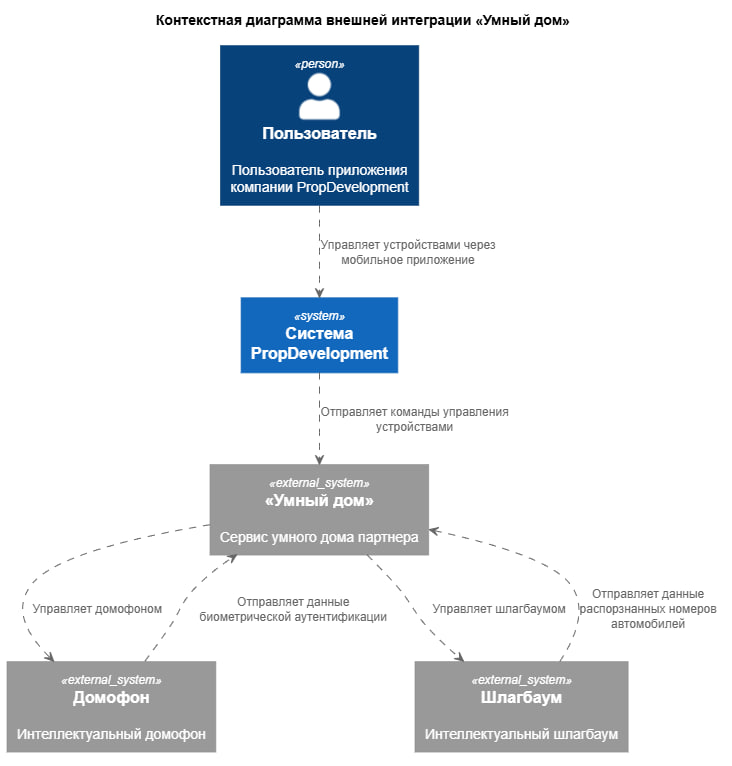
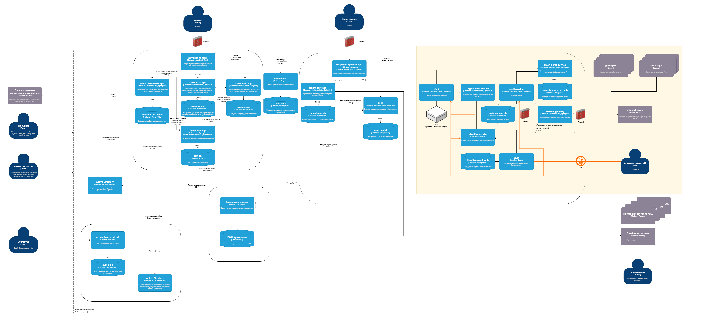

## Диаграмма контекста

## Диаграмма контейнеров

## Требования безопасности

| №   | Требование безопасности |
| --- | --- |
| 1 | Все запросы из и в систему должны проходить через шлюз интеграции, размещенный в DMZ |
| 2 | DMZ должен быть реализован через firewall и для связи система-шлюз, и для шлюз-внешняя система |
| 3 | Должен быть реализован принцип минимальных привелегий при работе с сервисом smart-home-core-app |
| 4 | Данные должны передаваться в зашифрованном виде |
| 5 | Должны вестись журналирование, мониторинг и аудит сервисов |
| 6 | Должно вестись журналирование всех операций доступа к системам и данным |
| 7 | Должен быть организован контроль доступа на основе ABAC для взаимодействия пользователей с домофонами и шлагбаумами |
| 8 | Должны использоваться средства централизованного контроля доступа и отзыва прав доступа |
| 9 | БД сервиса должна быть зашифрована для избежания утечки ПД |
| 10 | Должна быть разработана и поддерживаться в актуальном состоянии политика классификации данных |
| 11 | Должно быть настроено регулярное резервное копирование данных и их сохранение в защищённых хранилищах |
| 12 | Должны быть настроены механизмы управления и ротации ключами шифрования |
| 13 | Действия с ключами шифрования должны журналироваться |
| 14 | Сотрудники ИБ должны подключаться к сервисам контура через VPN и проходить MFA |
| 15 | Должна быть настроена SIEM система, а также настроены автоматические оповещения сотрудникам ИБ |
| 16 | Реализовать RBAC в identity-provider для разграничения доступов сотрудникам ИБ, внешним системам |

## Аутентификация

| Аутентификация | Соединение | Назначение |
| --- | --- | --- |
| OAuth 2.0 | «Умный дом» -> identity-provider | Получение токена для межсистемного взаимодействия |
| mTLS | «Умный дом» -> external-gateway | Аутентификация взаимодействий между системами |
| VPN + MFA | Администратор ИБ -> Корпоративная инфраструктура | Аутентификация сотрудников в системе |
| OAuth 2.0 | Внутренние сервисы -> identity-provider | Получение токена для межсервисного взаимодействия |

## Авторизация

| Авторизация | Взаимодействие | Назначение |
| --- | --- | --- |
| ABAC | Пользователь -> smart-home-service | Проверка доступа к устройствам по атрибутам пользователя |
| RBAC | Пользователь -> smart-home-service | Проверка доступа к действиям с устройствами |
| RBAC | Внешняя платформа -> external-gateway | Проверка доступов к API |
| RBAC | Администратор ИБ -> SIEM | Разграничение прав административных полномочий |
| RBAC | Администратор ИБ -> KMS | Разграничение прав административных полномочий |
| RBAC | Администратор ИБ -> crypto-audit-service | Разграничение прав административных полномочий |
| RBAC | Администратор ИБ -> audit-service | Разграничение прав административных полномочий |
| RBAC | Администратор ИБ -> identity-provider | Разграничение прав административных полномочий |

## Сценарии взаимодействия

### 1. Пользователь -> PropDevelopment -> «Умный дом» -> Устройство

1. Пользователь совершает действие с устройством
0. smart-home-service проверяет доступ к устройству и право совершения действия с ним
0. smart-home-service формирует запрос
0. Запрос передаётся в external-gateway по защищённому каналу через Firewall
0. Шлюз формирует запрос во внешнюю платформу
0. Устанавливается защищённое соединение HTTPS с взаимной проверкой сертификатов внешней платформы и PropDevelopment по mTLS
0. Внешняя платформа выполняет операцию и возвращает результат
0. Шлюз принимает ответ и передаёт бизнес-сервису
0. Результат операции и сведения о взаимодействии регистрируются в Audit Service
0. smart-home-service выводит ответ пользователю

### 2. «Умный дом» -> PropDevelopment

1. «Умный дом» отправляет запрос к PropDevelopment
0. Firewall проверяет, разрешен ли запрос
0. external-gateway принимает запрос, проверяет сертификат, токен и права доступа
0. Шлюз передает запрос на smart-home-service через Firewall
0. smart-home-service проверяет доступы и проводит необходимые действия для обработки запроса (запрос ключей у KMS, шифрование ПД, сохранение в БД)
0. События регистрируются в Audit Service
0. smart-home-service формирует ответ, передает на шлюз
0. Шлюз возвращает ответ внешней системе

